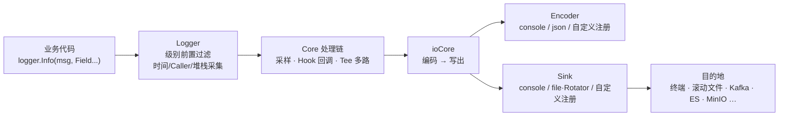

<div align="center">

# go-logger

**基于 Go 标准库的零依赖高性能日志库**

高性能编码 · 滚动切割 · 结构化字段 · 多路输出 · 采样限流 · 动态级别

[](https://go.dev)
[](#特性)
[](#测试)
[](docs/BENCHMARK.md)

[快速开始](#快速开始) · [常用场景](#常用场景) · [配置项](#配置项) · [API 速查](#api-速查) · [性能](#性能) · [扩展开发](#扩展开发)

</div>

---

## 特性

| | |
|---|---|
| ⚡ **零依赖** | 仅 Go 标准库，无第三方依赖，无传递依赖，`go.mod` 干净如初 |
| 🚀 **开箱即用** | import 后直接调用，无需任何初始化代码 |
| 🏎️ **高性能** | 缓冲池编码、类型化字段零装箱、池化 Entry——纯消息路径 **0 堆分配**，全面快于 zap |
| 📦 **滚动切割** | 按大小切割、按个数/天数清理、可选 gzip 压缩 |
| 📋 **结构化日志** | 强类型字段 + 键值对 + JSON 行编码，可直接对接 ELK / Loki 等采集管道 |
| 🎨 **彩色控制台** | 级别着色（DEBUG 绿 / INFO 蓝 / WARN 黄 / ERROR 红），零分配实现 |
| 🔧 **动态级别** | 运行期 `SetLevel` 原子生效，排查问题不重启进程 |
| 🚰 **采样限流** | zap sampler 同款算法，高频重复日志自动降频防刷屏 |
| 🔌 **三层扩展** | `Sink` / `Core` / `Encoder` 接口 + 注册表，Kafka / ES / StarRocks / MinIO 按需接入 |

## 安装

```bash
go get github.com/hicode0101/go-logger
```

```go
import "github.com/hicode0101/go-logger"
```

## 快速开始

不调用 `Init` 也完全可以——首次日志调用时自动按默认配置初始化（控制台 + `logs/app.log`）：

```go
package main

import (
	"errors"

	"github.com/hicode0101/go-logger"
)

func main() {
	defer logger.Close() // 进程退出前刷缓冲并释放文件句柄（推荐）

	logger.Debug("调试信息，生产环境会被级别过滤掉")
	logger.Info("用户 %s 登录成功", "Tom") // 格式串风格
	logger.Warn("磁盘使用率 %v%%", 85.5)
	logger.Error("数据库连接超时") // error 及以上自动附带调用堆栈
	logger.ErrorWithErr("读取配置失败", errors.New("file not found"))

	// 键值对（kv 成对传入）
	logger.Infow("下单成功", "orderNo", "NO20240101", "amount", 99.5)

	// 强类型字段（性能最优路径，零装箱分配）
	logger.GetLogger().Info("支付回调",
		logger.String("orderNo", "NO20240101"),
		logger.Int("uid", 10001),
		logger.Float64("amount", 99.5),
	)
}
```

控制台输出（级别着色，含时间与调用位置）：

```text
2024-06-01 12:30:45.123	INFO	main/main.go:12	用户 Tom 登录成功
2024-06-01 12:30:45.124	WARN	main/main.go:13	磁盘使用率 85.5%
2024-06-01 12:30:45.125	ERROR	main/main.go:14	数据库连接超时
goroutine 1 [running]:
main.main()
	.../main.go:14
```

## 架构设计

一条日志从业务代码到目的地经过三层抽象，每层都可以替换或扩展：



- **Core**：日志事件的处理链节点，负责级别过滤、采样、多路分发（对齐 `zapcore.Core` 模型）；
- **Encoder**：把 Entry + Fields 编码为字节（内置 `console` / `json`，可注册自定义格式）；
- **Sink**：字节流的最终目的地（内置 `console` / `file` 内建滚动切割器，可注册自定义目的地）。

技术实现细节见 [docs/DESIGN.md](docs/DESIGN.md)，扩展实现骨架见 [docs/EXTEND.md](docs/EXTEND.md)。

## 常用场景

### 场景 1：开箱即用，零配置打日志

最适合脚本、小工具、原型开发——一行配置都不用写：

```go
logger.Info("服务启动")
```

默认行为：`debug` 级别、控制台彩色输出 + `logs/app.log` 滚动文件（单文件 1GB 上限、保留 10 个、7 天）。

### 场景 2：生产环境——级别控制 + 滚动切割 + 压缩归档

```go
cfg := logger.DefaultConfig()
cfg.Level = "info" // 只输出 info 及以上，代码里的 Debug 调用自动变零成本空操作
cfg.FilePath = "/var/log/myapp/app.log"
cfg.MaxSizeMB = 100   // 单文件最大 100MB，超过自动切割
cfg.MaxBackups = 30   // 最多保留 30 个历史文件
cfg.MaxAgeDays = 15   // 历史文件最长保留 15 天
cfg.Compress = true   // 历史文件 gzip 压缩
if err := logger.Init(cfg); err != nil {
	panic(err) // 只有 Level 非法才会报错
}
defer logger.Close()
```

切割行为（lumberjack 等价语义）：

```text
logs/app.log                        ← 当前写入文件（始终是这个名字）
logs/app-2024-06-01T12-30-45.123.log ← 超限时重命名的备份
logs/app-2024-06-01T12-30-45.123.log.gz ← Compress=true 时的压缩归档
```

超限时当前文件按时间戳改名，随后新建 `app.log` 继续写入；历史文件按个数、按文件名时间戳的天数双重清理。

### 场景 3：JSON 结构化日志，对接采集管道

文件输出切换为 JSON 行编码，Filebeat / Fluentd / Vector 等采集器可直接解析：

```go
cfg := logger.DefaultConfig()
cfg.Encoding = "json" // 文件输出 JSON；控制台保持人类可读的彩色格式
_ = logger.Init(cfg)
```

```json
{"level":"info","time":"2024-06-01 12:30:45.123","caller":"main/main.go:12","msg":"下单成功","orderNo":"NO20240101","amount":99.5}
```

error 及以上级别的日志自动附带 `stacktrace` 字段，线上排错无需重现堆栈。

### 场景 4：开发调试——只看彩色控制台，不产生文件

```go
cfg := logger.DefaultConfig()
cfg.File = false        // 不落盘
cfg.Development = true  // DPanic 级别直接 panic，断言失败立即暴露
_ = logger.Init(cfg)
```

调试期细节全开（默认 `debug` 级别），ERROR 级别的堆栈直接打在终端上。

### 场景 5：运行期动态调级，线上排查不重启

级别开关是原子变量，`SetLevel` 即时生效、同时作用于所有输出目的地：

```go
_ = logger.SetLevel("debug") // 收到排查信号（如 SIGHUP / 后台开关）时打开
...排查...
_ = logger.SetLevel("info")  // 排查完恢复

if logger.GetLevel() == logger.DebugLevel {
	// 级别过滤前的廉价预判，避免构造昂贵参数
}
```

也可以只调某个子日志器：`dbLog := logger.Named("db")`，实例方法 `Enabled(lv)` 支持按需短路。

### 场景 6：结构化字段——三种 API 形态怎么选

| API 形态 | 示例 | 适用场景 |
|---|---|---|
| 格式串 `*f` | `logger.Infof("用户 %s 登录", name)` | 人类阅读的终端输出 |
| 键值对 `*w` | `logger.Infow("下单", "orderNo", no)` | 便捷、灵活，kv 成对传入 |
| 强类型字段 | `log.Info("下单", logger.String("orderNo", no))` | **性能最优**：零接口装箱，热路径推荐 |

```go
log := logger.GetLogger()
log.Info("支付回调处理完成",
	logger.String("orderNo", "NO20240101"),
	logger.Int("uid", 10001),
	logger.Float64("amount", 99.5),
	logger.Bool("retried", false),
	logger.Duration("cost", 350*time.Millisecond), // 编码为秒
	logger.Time("paidAt", paidAt),                  // 内置时间格式
	logger.Err(err),                                // {"error": "..."}，nil 时自动省略
	logger.Any("extra", anything),                  // 兜底走 fmt，高频路径避免使用
)
```

完整字段构造函数见 [API 速查](#api-速查)。

### 场景 7：高吞吐写入——缓冲写（10× 提速）

高 QPS 服务建议开启缓冲写：64KB 聚合缓冲 + 后台定时刷盘，把每条日志的落盘开销从微秒级降到百纳秒级：

```go
cfg := logger.DefaultConfig()
cfg.FileBufferSizeKB = 64  // >0 启用缓冲写
cfg.FlushIntervalSec = 30  // 后台刷盘周期（默认 30s）
_ = logger.Init(cfg)
```

> 权衡：崩溃时最多丢失一个刷盘周期内的日志。对账、审计类日志请保持直写（`FileBufferSizeKB=0`，每条落盘、崩溃不丢）。

### 场景 8：高频重复日志——采样限流

防御循环报错、每请求同一句这类高频刷屏：

```go
cfg := logger.DefaultConfig()
cfg.Sampling = &logger.SamplingConfig{Initial: 5, Thereafter: 50}
_ = logger.Init(cfg)
// 同一分钟内同一消息：前 5 条全量记录，之后每 50 条取 1 条
```

计数按（级别 × 消息内容）维度进行，锁-free 原子实现，与 zap sampler 同款算法。

### 场景 9：多路输出——一个应用，多个目的地

`Sinks` 配置非空时完全按列表构建，每路可独立指定格式、级别、颜色、缓冲：

```go
_ = logger.Init(logger.Config{
	Level: "info",
	Sinks: []logger.SinkConfig{
		// 运维屏幕：只收 warn 及以上，带颜色，直写不缓冲
		{Type: "console", Format: "console", Color: true, Level: "warn"},
		// 采集管道：JSON 全量，64KB 缓冲写
		{Type: "file", Format: "json", Path: "logs/app.json.log",
			MaxSizeMB: 100, MaxBackups: 7, MaxAgeDays: 30, BufferSizeKB: 64},
		// 自定义注册的远程目的地（见场景 12）
		// {Type: "kafka", Format: "json", BufferSizeKB: 64,
		//	Options: map[string]string{"brokers": "...", "topic": "logs"}},
	},
})
```

> 每路的 `Level` 只能**收紧**（高于全局级别），不能放宽到全局级别以下。

### 场景 10：子日志器与上下文字段——链路追踪

```go
httpLog := logger.Named("http") // 子日志器：输出中带 logger 名称
dbLog := logger.Named("db")

reqLog := logger.WithFields(map[string]interface{}{
	"requestId": "req-9f8e7d",
	"uid":       10001,
})
reqLog.Info("开始处理下单") // 每条日志自动携带 requestId/uid 字段
```

JSON 输出效果：

```json
{"level":"info","time":"2024-06-01 12:30:45.123","logger":"http","caller":"http/handler.go:42","msg":"listening on :8080"}
{"level":"info","time":"2024-06-01 12:30:45.124","caller":"order/order.go:18","msg":"开始处理下单","requestId":"req-9f8e7d","uid":10001}
```

实例派生同样支持：`log.With(logger.String("module", "order"))` 返回携带固定字段的新实例。

### 场景 11：错误、堆栈与 Panic/Fatal

```go
if err := os.ReadFile(path); err != nil {
	logger.ErrorWithErr("读取配置文件失败", err) // error 以独立字段记录，方便检索
	// 输出：... ERROR ... 读取配置文件失败	{"error": "open app.yaml: no such file or directory"}
}
```

| 方法 | 行为 | 典型用途 |
|---|---|---|
| `logger.Error(...)` | 写日志（自动附堆栈）后继续运行 | 需要关注但可继续的异常 |
| `logger.Panic(...)` | **先写日志再 panic** | 交给 recover 统一兜底的致命分支 |
| `logger.Fatal(...)` | 先写日志 → `Sync` → `os.Exit(1)` | 启动期不可恢复失败（defer 不执行） |
| `logger.DPanic(...)` | `Development=true` 时 panic，生产等同 Error | 开发期断言 |

`DisableStacktrace = true` 可关闭 error 及以上级别的自动堆栈；`DisableCaller = true` 可关闭调用位置记录（省去 caller 采集开销）。caller 默认展示为**最后两级相对路径**（如 `main/main.go:12`，与旧版及 zap `ShortCallerEncoder` 一致），完整路径的取用方式见[常见问题](#常见问题)。

### 场景 12：扩展——自定义目的地与输出格式

**接入远程目的地**（Kafka / ES / StarRocks / MinIO 等）：实现 `Sink` 接口（`io.Writer` + `Close` + `Sync`），注册工厂后即可在 `Sinks` 配置中引用，不引入任何第三方依赖到本模块：

```go
type kafkaSink struct{ /* producer、批量队列 … */ }

func (k *kafkaSink) Write(p []byte) (int, error) { return k.enqueue(p) }
func (k *kafkaSink) Sync() error                 { return k.flush() }
func (k *kafkaSink) Close() error                { return k.close() }

func init() {
	logger.RegisterSink("kafka", func(cfg logger.SinkConfig) (logger.Sink, error) {
		return newKafkaSink(cfg.Options["brokers"], cfg.Options["topic"])
	})
}
```

```go
_ = logger.Init(logger.Config{
	Sinks: []logger.SinkConfig{{
		Type: "kafka", Format: "json", BufferSizeKB: 64,
		Options: map[string]string{"brokers": "b1:9092", "topic": "logs"},
	}},
})
```

**自定义输出格式**：实现 `Encoder` 接口并注册（内置 `console` / `json`，可用 `logger.NewJSONEncoder` / `NewConsoleEncoder` 包装改造，`logger.TimeLayout()` 提供内置时间格式）：

```go
type logfmtEncoder struct{}

func (logfmtEncoder) Encode(buf *logger.Buffer, e *logger.Entry, fields []logger.Field) {
	buf.AppendString(e.CallerString()) // 自由组织输出
	// ... buf 提供 AppendString/AppendInt/AppendFloat/AppendTime/AppendQuote 等
}
func (logfmtEncoder) Clone() logger.Encoder { return logfmtEncoder{} }

func init() {
	logger.RegisterEncoder("logfmt", func(c logger.EncoderConfig) logger.Encoder {
		return logfmtEncoder{}
	})
}
```

**直接使用滚动切割器**：`Rotator` 是标准 `io.Writer`，可独立搭配任何日志库使用：

```go
rot, _ := logger.NewRotator("logs/app.log", 100, 7, 30, true, false)
defer rot.Close()
rot.Write([]byte("hello")) // 超限自动切割、清理、压缩
```

四类远程目的地的完整实现骨架（批量、异步、幂等等要点）见 **[docs/EXTEND.md](docs/EXTEND.md)**，Kafka 与 ES 的可运行示例见 [example/](example/) 目录。

## 配置项

### Config

| 字段 | 类型 | 默认值 | 说明 |
|---|---|---|---|
| `Level` | string | `debug` | 日志级别：debug / info / warn / error / dpanic / panic / fatal（大小写均可） |
| `Console` | bool | `true` | 是否输出到控制台 |
| `File` | bool | `true` | 是否写入滚动日志文件 |
| `FilePath` | string | `logs/app.log` | 日志文件路径 |
| `MaxSizeMB` | int | `1024` | 单文件最大体积（MB），超过后自动切割 |
| `MaxBackups` | int | `10` | 最多保留的历史文件个数（0 = 不限） |
| `MaxAgeDays` | int | `7` | 历史文件最长保留天数（0 = 不限） |
| `Compress` | bool | `false` | 是否 gzip 压缩历史文件 |
| `Development` | bool | `false` | 开发模式：DPanic 级别直接 panic |
| `Encoding` | string | `console` | **文件**输出编码：`console` / `json` / 注册的自定义编码器 |
| `ConsoleColor` | bool | `true` | 控制台级别着色 |
| `DisableCaller` | bool | `false` | 关闭调用位置（file:line）记录 |
| `DisableStacktrace` | bool | `false` | 关闭 error 及以上级别的堆栈记录 |
| `Sampling` | *SamplingConfig | `nil` | 重复消息采样：`Initial` 每分钟前 N 条全量，`Thereafter` 之后每 M 条取 1 |
| `FileBufferSizeKB` | int | `0`（直写） | 文件缓冲写大小（KB），>0 启用 |
| `FlushIntervalSec` | int | `30` | 缓冲写后台刷盘周期（秒），仅缓冲模式生效 |
| `Sinks` | []SinkConfig | `nil` | 多路输出配置；非空时 Console/File 等旧字段被忽略 |

所有基础字段留零值时自动取默认值，`logger.Init(logger.DefaultConfig())` 与默认行为完全一致。

### SinkConfig（多路输出时的单路配置）

| 字段 | 说明 |
|---|---|
| `Type` | sink 类型：`console` / `file` / `RegisterSink` 注册的自定义名 |
| `Format` | 编码器：`console` / `json` / `RegisterEncoder` 注册的自定义名 |
| `Level` | 独立级别（只能高于全局级别）；空表示跟随全局 |
| `Color` | console 类型是否着色（仅 console 编码时生效） |
| `Path` / `MaxSizeMB` / `MaxBackups` / `MaxAgeDays` / `Compress` / `LocalTime` | file 类型滚动切割参数 |
| `BufferSizeKB` / `FlushIntervalSec` | 缓冲写（file 及自定义 sink 通用） |
| `Options` | 自定义 sink 的扩展参数（Kafka brokers、ES 地址、bucket…） |

## API 速查

### 包级日志函数（全局 logger）

| 方法 | 签名 | 说明 |
|---|---|---|
| `Debug/Info/Warn/Error` | `(f interface{}, v ...interface{})` | 三形态参数：纯文本 / fmt 格式串 / 任意值 |
| `Debugf/Infof/Warnf/Errorf` | `(format string, args ...interface{})` | 显式 fmt 格式串 |
| `Debugw/Infow/Warnw/Errorw` | `(msg string, kv ...interface{})` | 键值对（kv 成对传入） |
| `ErrorWithErr` | `(msg string, err error)` | 错误以独立字段记录 |
| `Panic/DPanic/Fatal` 及 `*w` 变体 | 同上 | 写日志后 panic / 条件 panic / 退出 |
| `Named` | `(name string) *Logger` | 子日志器 |
| `WithFields` | `(map[string]interface{}) *Logger` | 携带上文字段的实例 |
| `GetLogger` | `() *Logger` | 取全局实例 |
| `SetLevel / GetLevel` | 动态级别 | 原子生效 |
| `Init / DefaultConfig` | 配置 | 可重复调用，重建前自动收尾旧资源 |
| `Sync / Close` | 收尾 | 刷缓冲 / 刷缓冲并释放句柄 |

### Logger 实例方法（`*Logger`）

```go
log.Debug(msg string, fields ...Field)   // 实例方法 msg 直接收 string，字段走强类型
log.Info / Warn / Error / DPanic / Panic / Fatal(msg string, fields ...Field)
log.Debugf / Infof / Warnf / Errorf(format string, args ...interface{})
log.Debugw / Infow / Warnw / Errorw / Fatalw / Panicw / DPanicw(msg string, kv ...interface{})
log.With(fields ...Field) *Logger        // 派生携带固定字段的实例
log.Named(name string) *Logger           // 派生子日志器
log.Enabled(lv Level) bool               // 廉价预判
log.Sync() / log.Close() error
```

### 字段构造函数（`Field`）

| 构造 | 存储方式 | 说明 |
|---|---|---|
| `String(key, val string)` | 直接持有 | 字符串 |
| `Int / Int32 / Int64(key, val)` | int64 直存 | 整型 |
| `Uint64(key, val uint64)` | uint64 直存 | 无符号整型 |
| `Float64(key, val float64)` | IEEE754 位模式 | **零装箱** |
| `Bool(key, val bool)` | int 直存 | 布尔 |
| `Duration(key, val time.Duration)` | 纳秒 int64 | 编码为秒 |
| `Time(key, val time.Time)` | UnixNano int64 | 编码为内置时间格式（`TimeLayout()`） |
| `Err(err) / NamedErr(key, err)` | error 持有 | `{"error": "..."}`，nil 时编码期省略 |
| `Any(key, val interface{})` | interface 持有 | 兜底走 fmt，**高频路径避免使用** |

### 扩展与底层构件

| API | 说明 |
|---|---|
| `RegisterSink(typ, factory)` / `RegisterEncoder(name, factory)` | 注册自定义目的地 / 编码器 |
| `NewLogger(core)` | 用自定义 Core 构造日志器实例（结构化目的地扩展点，实例方法与全局一致） |
| `NewRotator(path, maxSizeMB, maxBackups, maxAgeDays, compress, localTime)` | 滚动切割器（标准 `io.Writer`） |
| `NewCore(level, encoder, sink)` / `NewTee(cores...)` | 组装自定义核心 / 多路合并 |
| `AddHook(core, hooks...)` | 给核心附加回调（`Hook func(*Entry) error`） |
| `NewAtomicLevel(l)` | 动态级别开关（`Enabled/Level/Set`） |
| `NewJSONEncoder(cfg)` / `NewConsoleEncoder(cfg)` | 内置编码器构造（可包装改造） |
| `NewLockedSink(s)` / `NewDiscardSink()` | 互斥包装 / 丢弃 |
| `TimeLayout()` / `ConsoleColor` | 内置时间格式 / ANSI 颜色常量（`logger.BrightRed.Format("FAILED")`） |

## 性能

与 uber-go/zap v1.28.0 的完整对比（同机、同负载、同编码格式，5 轮均值）见 **[docs/BENCHMARK.md](docs/BENCHMARK.md)**。结论摘要（i7-12700H，20 线程）：

| 场景 | go-logger | zap | 差距 |
|---|---|---|---|
| JSON · 纯消息 | **156 ns / 0 alloc** | 367 ns / 0 alloc | **快 2.3×** |
| JSON · 10 字段（强类型） | **660 ns / 1 alloc** | 1117 ns / 1 alloc | **快 1.7×** |
| JSON · 10 字段（kv） | **980 ns** | 1611 ns（Sugar） | **快 1.6×**，内存减半 |
| Console · 纯消息 | **65 ns / 0 alloc** | 421 ns / 3 allocs | **快 6.5×** |
| 并行 · 纯消息 | **25 ns / 0 alloc** | 43 ns / 0 alloc | **快 1.7×** |
| 文件直写（含切割器） | **2162 ns** | 2311 ns | 略快 6% |
| 文件缓冲写（64KB） | **216 ns** | —（无内建缓冲） | **快 10×** |
| 级别过滤 | 5.7 ns | 4.1 ns | 同数量级（归因分析见报告第五节） |

## 扩展开发

- **三层接口模型与契约**（Write 并发安全、Entry 生命周期、Enabled 廉价原则）：[docs/DESIGN.md](docs/DESIGN.md)
- **Elasticsearch / Kafka / StarRocks / MinIO 实现骨架**（批量、异步、幂等要点）：[docs/EXTEND.md](docs/EXTEND.md)

选择指南：

| 目的地形态 | 实现方式 |
|---|---|
| 字节流型（Kafka producer、HTTP 网关、MinIO 分片上传） | 实现 `Sink`，`RegisterSink` 注册，内部自行批量异步 |
| 结构体型（ES 文档、StarRocks Stream Load） | 实现 `Core`，`NewLogger(core)` 包装成日志器实例 |
| 新输出格式（logfmt、CSV、自定义报文） | 实现 `Encoder`，`RegisterEncoder` 注册 |

**可直接运行的示例**（独立模块，SDK 不进入主模块依赖树）：

| 示例 | 内容 | 运行 |
|---|---|---|
| [example/basic](example/basic) | 重构前 v1 全部功能对等演示（级别/格式/切割/动态级别/Named…） | `go run ./basic` |
| [example/base2](example/base2) | v1 观感对齐专项对比：彩色控制台 / 无色日志文件 / 自动滚动，三项均程序化证实 | `go run ./base2` |
| [example/base3](example/base3) | base2 的 JSON 形态：同样的测试代码，控制台与文件双路 JSON 行输出 | `go run ./base3` |
| [example/base4](example/base4) | base3 的 ES 形态：JSON 行接入 Elasticsearch（接入代码独立 es.go，RegisterSink 一路声明） | `go run ./base4` |
| [example/base5](example/base5) | base3 的 Kafka 形态：JSON 行接入 Kafka（接入代码独立 kafka.go，RegisterSink 一路声明） | `go run ./base5` |
| [example/kafka](example/kafka) | 字节流 Sink 接入 Kafka（拷贝入队、有界队列、批量异步、本地双写兜底） | `go run ./kafka` |
| [example/elasticsearch](example/elasticsearch) | 结构化 Core 接入 ES（内建 JSON 编码、按天索引路由、_bulk 批量） | `go run ./elasticsearch` |


## 测试

```bash
go test ./... -race                        # 全量单元测试 + 竞态检测
go test -run='^$' -bench=. -benchmem       # 主模块微基准（级别过滤归因等）

cd benchmark                               # 与 zap 的对比基准（独立模块，需 zap）
go test -bench=. -benchmem -count=5 > bench_results.txt
```

## 常见问题

<details>
<summary><b>为什么 import 之后不调用 Init 也有输出？如何彻底静默？</b></summary>

首次日志调用时自动按 `DefaultConfig()` 初始化（控制台 + `logs/app.log`）。需要静默时：

```go
_ = logger.Init(logger.Config{Console: false, File: false})
```

</details>

<details>
<summary><b>caller 显示的路径规则是什么？能输出完整路径吗？</b></summary>

默认裁剪为**最后两级**（`main/main.go:12`），与旧版及 zap `ShortCallerEncoder` 一致，避免暴露构建机器的目录结构。完整路径始终保存在 `Entry.CallerFile`，自定义 Core / 编码器可直接取用；通过 `logger.NewLogger` 自建编码器时，传 `logger.EncoderConfig{FullCallerPath: true}` 可让内置编码器输出完整路径：

```go
core := logger.NewCore(logger.NewAtomicLevel(logger.InfoLevel),
    logger.NewConsoleEncoder(logger.EncoderConfig{FullCallerPath: true}), sink)
log := logger.NewLogger(core)
```

</details>

<details>
<summary><b>进程崩溃会丢日志吗？</b></summary>

- 直写模式（`FileBufferSizeKB=0`，默认）：每条日志直接落盘，不丢；
- 缓冲写模式：崩溃时最多丢一个刷盘周期（默认 30s）内的日志。对账、审计类日志请保持直写。
- 无论哪种模式，`Fatal` 退出前会自动 `Sync`。

</details>

<details>
<summary><b>并发安全吗？</b></summary>

安全。`Rotator` 内部互斥、`Sink` 实现约定并发安全、级别开关为原子变量、Entry 走池化复用——单元测试包含多协程并发写与行数一致性校验（`-race` 通过）。

</details>

<details>
<summary><b>和 zap 怎么选？</b></summary>

- 选 **go-logger**：要求零第三方依赖、需要开箱即用的滚动切割（zap 需额外引入 lumberjack）、看重编码性能（快 1.4~6.5×）；
- 选 **zap**：已有 zap 生态（自定义 zapcore 生态、Sugar 语法糖生态）或团队既有代码深度绑定 zap 时。

详细数据与测试方法：[docs/BENCHMARK.md](docs/BENCHMARK.md)。

</details>

---

<div align="center">

**go-logger** · 纯 Go 标准库实现 · [技术设计](docs/DESIGN.md) · [扩展指南](docs/EXTEND.md) · [性能报告](docs/BENCHMARK.md)

</div>
